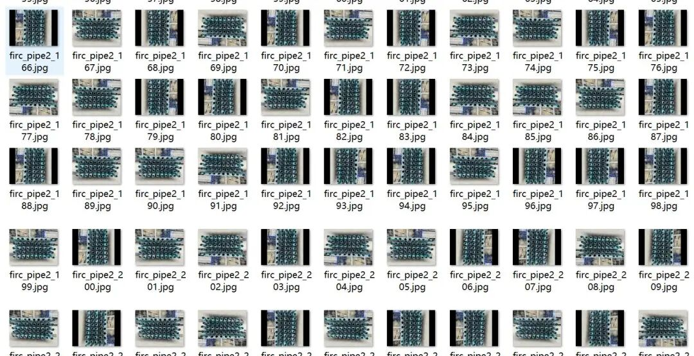
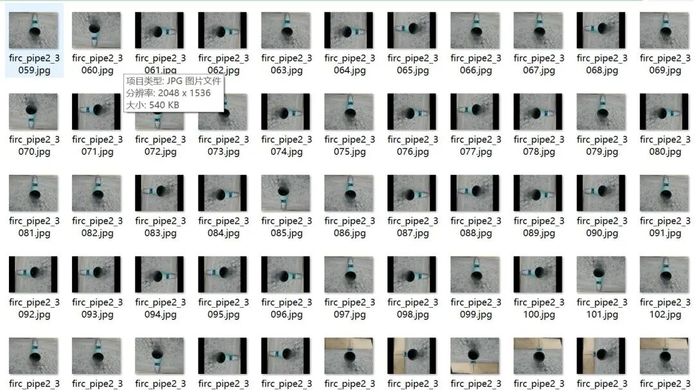
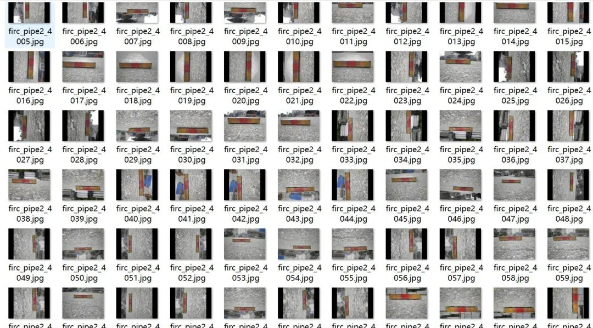
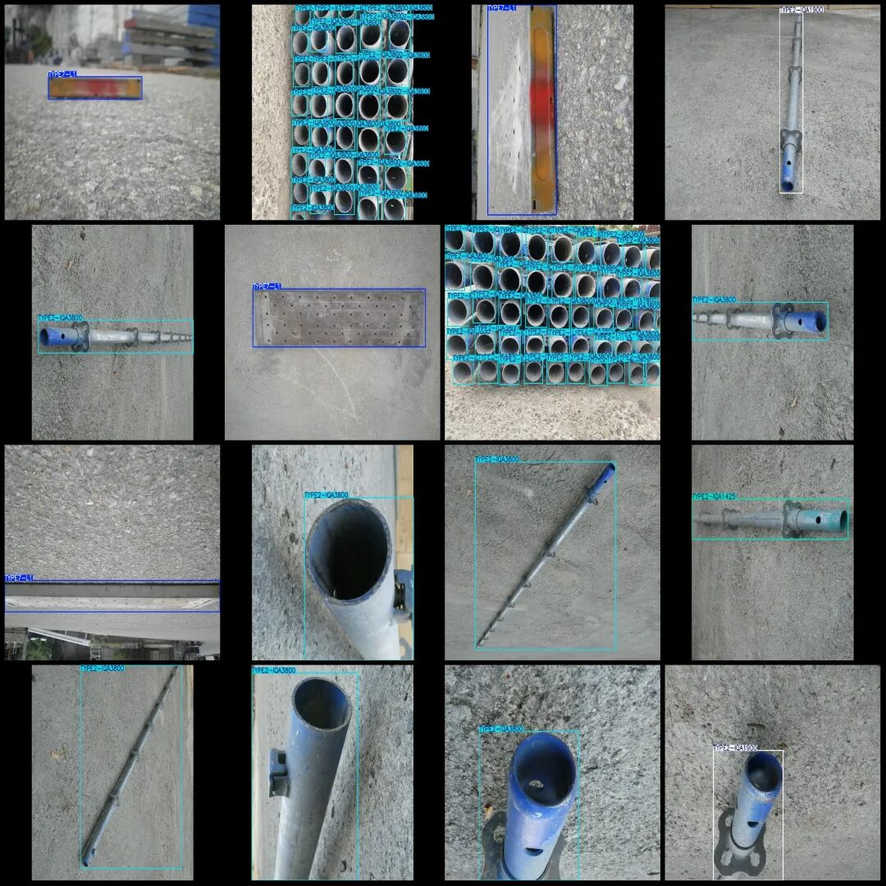

# Pipe Counting Detection Dataset VOC+YOLO format with 4651 images in 5 categories

Dataset format: Pascal VOC format + YOLO format (txt file without split path, only containing jpg images and corresponding VOC format xml files and yolo format txt files)

Number of images (number of jpg files): 4651

Number of annotations (number of xml files): 4651

Number of annotations (number of txt files): 4651

Label category count: 5

Label category names (note that the order of yolo format categories does not correspond to this, but is based on the classes.txt in the labels folder): ["TYPE1-P05", "TYPE2-IQA1425", "TYPE2-IQA1900", "TYPE2-IQA3800", "TYPE7-L1"]

Number of boxes labeled in each category:

TYPE1-P05 Frame count = 2630

TYPE2-IQA1425 Frames = 19789

TYPE2-IQA1900 Frame Count = 1426

TYPE2-IQA3800 Frame Count = 8422

TYPE7-L1 Frame Count = 716

Total frame count: 32983

Image resolution: 2048x1536

Is the dataset enhanced: some enhancements

Using labelImg:

Annotation rules: Draw a rectangle around the category.

Important Notice: No

Special : This dataset does not guarantee the accuracy of the trained models or weight files.

Image Preview:

Annotation example:

## Payment

Here is a pay link on Stripe ( https://buy.stripe.com/3cs8yP7sY87d0vu9AB ). Please contact me lonlonago@foxmail.com after funding $89, and I will send you a complete data files , thank you!

